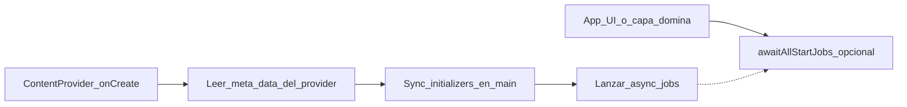

# app-startup-extension frente a AndroidX App Startup: optimizar el inicio con coroutines

*Artículo técnico orientado a equipos Android que ya usan o conocen [App Startup](https://developer.android.com/topic/libraries/app-startup).*

---

## 1. Contexto: por qué existe App Startup en AndroidX

La documentación oficial describe Jetpack App Startup como una forma **directa y eficiente** de inicializar componentes al arrancar la aplicación. Sustituye el patrón de declarar *un ContentProvider por cada* librería: esos proveedores son costosos de instanciar y el sistema puede inicializarlos en **orden no determinista**. Con un solo `androidx.startup.InitializationProvider` y metadatos en el manifiesto, las apps definen **inicializadores de componente** y el orden vía `dependencies()`.

Cada inicializador implementa `Initializer<T>` con:

- `create(context): T` — operaciones para construir el componente (llamada **síncrona**).
- `dependencies(): List<Class<out Initializer<*>>>` — qué otros `Initializer` deben ejecutarse antes.

El registro en el manifiesto usa `android:value="androidx.startup"` en el `<meta-data>` bajo el `InitializationProvider`. Los inicializadores alcanzables por dependencias no requieren entrada explícita en el manifiesto.

**Consecuencia importante:** todo el modelo gira en torno a `create()` **bloqueante**. El trabajo pesado (disco, red, CPU larga) compite con el hilo en el que la biblioteca ejecuta la cadena de inicialización; en la práctica, los equipos suelen minimizar lo que ocurre en `create()` o mover trabajo a hilos propios con reglas de sincronización a medida.

---

## 2. Propósito de **app-startup-extension**: optimizar el inicio de la aplicación

[app-startup-extension](https://github.com/santimattius/android-app-startup-extension) (coordenadas Maven: `io.github.santimattius.android:app-startup-extension`) extiende la misma idea base —un `ContentProvider` que descubre inicializadores desde el manifiesto— pero **separa explícitamente** dos clases de trabajo:


| Objetivo de optimización                                | Cómo lo aborda la extensión                                                                                                                                                      |
| ------------------------------------------------------- | -------------------------------------------------------------------------------------------------------------------------------------------------------------------------------- |
| **Acortar el camino crítico en el hilo principal**      | Inicializadores **síncronos** (`StartupSyncInitializer`) solo para lo imprescindible; sin I/O bloqueante en `create()`.                                                          |
| **Sacar I/O y trabajo costoso del arranque bloqueante** | Inicializadores **asíncronos** (`StartupAsyncInitializer`) con `suspend fun create` y `dispatcher()` configurable (p. ej. `Dispatchers.IO`).                                     |
| **Orden correcto y menos sorpresas**                    | Dependencias entre sync, entre async, y `syncDependencies()` para que un async espere a sync concretos. Estrategias opcionales de orden topológico y validación del grafo async. |
| **Definir cuándo “terminó” el arranque en background**  | `awaitAllStartJobs()`, sobrecarga con **timeout**, `onAppStartupLaunched`, `startupState` (StateFlow).                                                                           |
| **Medir para recortar**                                 | `metricsFlow` / `StartupMetric` (duración, sync vs async, éxito, distinción cancelación vs error).                                                                               |
| **No retener memoria innecesaria**                      | `retainAfterStartup()` en sync y async para warmups transitorios.                                                                                                                |


En una frase: **no reemplaza** el concepto de App Startup, sino que **formaliza** el reparto entre “lo mínimo imprescindible en el main thread durante el provider” y “el resto en coroutines, con dependencias y puntos de sincronización claros”.

---

## 3. Comparación directa


| Aspecto                                            | AndroidX App Startup                       | app-startup-extension                                                                                         |
| -------------------------------------------------- | ------------------------------------------ | ------------------------------------------------------------------------------------------------------------- |
| **Interfaz principal**                             | `Initializer<T>`                           | `StartupSyncInitializer<T>` y `StartupAsyncInitializer<T>`                                                    |
| `**create()*`*                                     | Siempre **síncrono**                       | Sync: síncrono en main; async: `**suspend`** en el `dispatcher()` del initializer                             |
| **Dependencias**                                   | Solo `Initializer<*>` en `dependencies()`  | Sync ↔ sync; async ↔ async; además `**syncDependencies()`** en async hacia sync                               |
| **Registro en manifiesto**                         | `android:value="androidx.startup"`         | `android:value="sync-initializer"` o `android:value="async-initializer"` (según tipo)                         |
| **Esperar al fin del trabajo en background**       | No hay API de biblioteca unificada         | `awaitAllStartJobs()` / timeout / `onAppStartupLaunched`                                                      |
| **Métricas por initializer**                       | No incluidas en el contrato base           | `metricsFlow` + `StartupMetric`                                                                               |
| **Aislamiento de fallos entre tareas en paralelo** | Un solo modelo encadenado                  | Motor con `**SupervisorJob`**: un fallo async no cancela el resto                                             |
| **Orden / detección de ciclos**                    | Resolución en descubrimiento (doc oficial) | Estrategias: `**SyncOrderingStrategy`**, `**AsyncInitializerStrategy**` (p. ej. topológico o validado previo) |


---

## 4. Flujo de arranque (visión de conjunto)

El `InitializationProvider` de la extensión llama a `AppStartupInitializer.discoverAndInitialize`. Tras leer metadatos del paquete (`getProviderInfo`), se ejecutan primero los **sync** y luego se **lanzan** los **async** como jobs bajo el motor de coroutines.




- Los **sync** comparten el mismo riesgo que cualquier código en el hilo principal durante el arranque temprano: **ANR** si se bloquea demasiado tiempo.
- Los **async** no sustituyen la disciplina de diseño: deben usar el **dispatcher** adecuado y declarar dependencias reales.

---

## 5. Estrategias de configuración

`AppStartupInitializer.configure { }` debe llamarse **antes** de que corra el provider; el punto más temprano habitual es `Application.attachBaseContext`:

- `**SyncOrderingStrategy.Lazy`** (por defecto): orden tipo DFS; la detección de ciclos puede ocurrir **durante** la inicialización.
- `**SyncOrderingStrategy.Topological`**: orden topológico (Kahn) **antes** de cualquier `create()`; ciclos fallan de forma anticipada y con diagnóstico claro.
- `**AsyncInitializerStrategy.Concurrent`** (por defecto): cada async descubierto obtiene su propia corrutina; detección de ciclos perezosa por cadena.
- `**AsyncInitializerStrategy.Validated**`: se construye el grafo async–async antes de lanzar; solo se lanzan corrutinas en **raíces**; menos lanzamientos redundantes y ciclos detectados antes.

Ejemplo de esqueleto (valores ilustrativos):

```kotlin
override fun attachBaseContext(base: Context) {
    super.attachBaseContext(base)
    AppStartupInitializer.configure {
        debugLoggingEnabled = BuildConfig.DEBUG
        strictModeCheckEnabled = BuildConfig.DEBUG
        syncOrderingStrategy = SyncOrderingStrategy.Topological
        asyncInitializerStrategy = AsyncInitializerStrategy.Validated
    }
}
```

**StrictMode:** con `strictModeCheckEnabled`, el código de inicialización sync puede envolver el trabajo en una política que ayuda a detectar **I/O accidental** en debug (complemento a la revisión humana, no sustituto).

---

## 6. Buenas prácticas

### Partición sync vs async

- **Sync:** solo lo estrictamente necesario y **rápido**: sin lecturas/escrituras en disco, red, consultas a base de datos ni trabajo CPU largo. El propio contrato documenta el riesgo de ANR.
- **Async:** trabajo pesado aquí; sobreescribir `dispatcher()` a `Dispatchers.IO` (o un executor dedicado) cuando el trabajo sea bloqueante.

### Sincronización con el resto de la app

- Usar `awaitAllStartJobs()` o `onAppStartupLaunched { }` cuando una pantalla o un flujo requiera que ciertos inicializadores async hayan terminado.
- Usar `awaitAllStartJobs(timeoutMs)` si un escenario de red lenta no debe bloquear el arranque **indefinidamente**; el timeout cancela jobs aún activos en esa ruta.

### Observabilidad sin fugas

- Recolectar `metricsFlow` desde un **scope con ciclo de vida** (p. ej. `lifecycleScope`), no capturando `Activity` o `Fragment` en el singleton `AppStartupInitializer`.

### Memoria

- Usar `retainAfterStartup(false)` cuando el valor devuelto por `create` solo importa durante el arranque (warmup, migración con efectos laterales). Si alguien solicita de nuevo ese initializer más tarde, puede **re-ejecutarse** `create`: el diseño debe ser idempotente o evitar esa vía.

### Build (R8 / ProGuard)

- La librería aporta reglas de consumidor que **conservan** implementaciones concretas de `StartupSyncInitializer` y `StartupAsyncInitializer` y el `InitializationProvider`, porque la instanciación es por reflexión desde nombres de clase en el manifiesto. Cumplir la versión publicada y no eliminar reglas necesarias en módulos de app.

### Convivencia con AndroidX App Startup

- Es posible declarar **ambos** `InitializationProvider` en el manifiesto: el de AndroidX con `androidx.startup` y el de la extensión con `sync-initializer` / `async-initializer`. Planificar **qué** vive en cada biblioteca para no **duplicar** la misma inicialización en dos cadenas.

---

## 7. Ventajas, limitaciones y contras honestos

**Ventajas**

- Inicialización **asíncrona de primera clase** con coroutines y **dispatcher** por componente.
- **Dependencias cruzadas** sync → async vía `syncDependencies()`.
- **Punto de sincronización** explícito (`awaitAllStartJobs`, timeout, estado).
- **Métricas** integradas para priorizar optimizaciones reales.
- **SupervisorJob** en el motor: un error aislado en un initializer async no tumba a sus “hermanos”.
- **Estrategias** de orden y validación de grafos según el perfil de riesgo del equipo.
- `**retainAfterStartup`** para no anclar objetos al mapa interno toda la vida del proceso.

**Limitaciones y costes**

- **Dependencia adicional** y API que el equipo debe aprender.
- Los **sync** siguen ejecutándose en el **hilo principal** en el contexto del arranque del ContentProvider: la librería ayuda con StrictMode en debug, pero **no elimina** el riesgo ANR si el equipo abusa del lado síncrono.
- `**getProviderInfo`** sigue siendo una llamada IPC al `PackageManager`: latencia inherente al modelo basado en proveedor (una vez por proceso; conocido para quien perfila arranque).
- **Dos valores de meta-data** distintos del único `androidx.startup`: más superficie de manifest y convención de equipo.
- Coexistencia con AndroidX exige **disciplina** para no registrar dos veces la misma lógica.

---

## 8. Referencias

- Documentación oficial: [App Startup](https://developer.android.com/topic/libraries/app-startup) (conceptos de `Initializer`, `InitializationProvider`, `<meta-data>` y dependencias).
- Biblioteca: [android-app-startup-extension en GitHub](https://github.com/santimattius/android-app-startup-extension).
- Artefacto Maven (según `gradle.properties` del proyecto):  
`implementation("io.github.santimattius.android:app-startup-extension:<versión>")` — comprobar la versión publicada en Maven Central o en el README del repositorio.

---

*Contenido alineado con la implementación del módulo `core/` y con los extractos de la base de conocimiento Android consultados mediante la herramienta `android docs fetch` de Android CLI.*