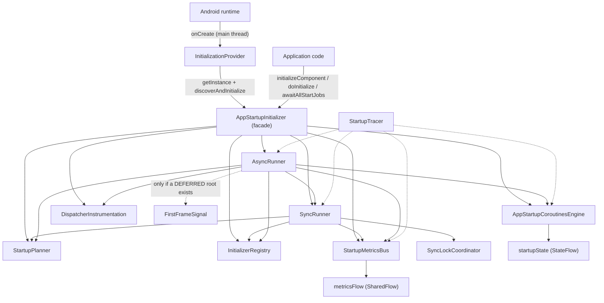
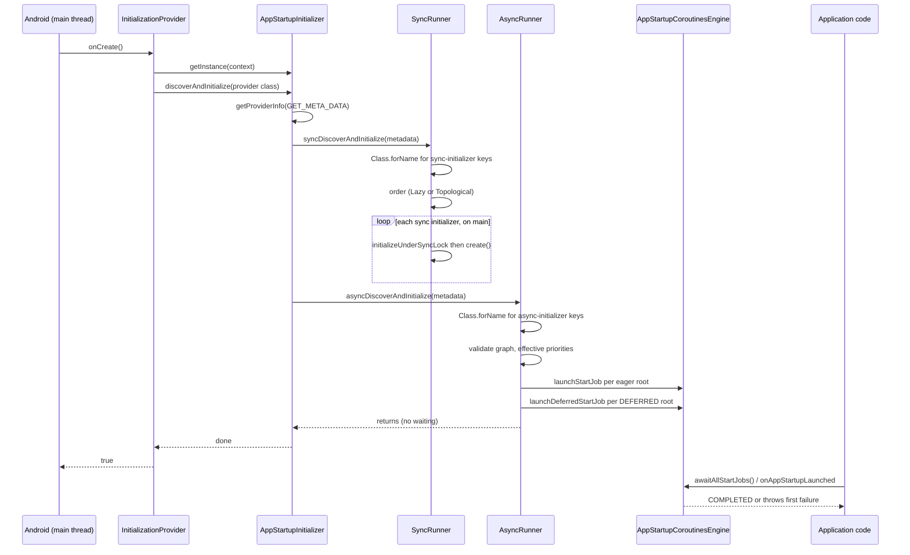
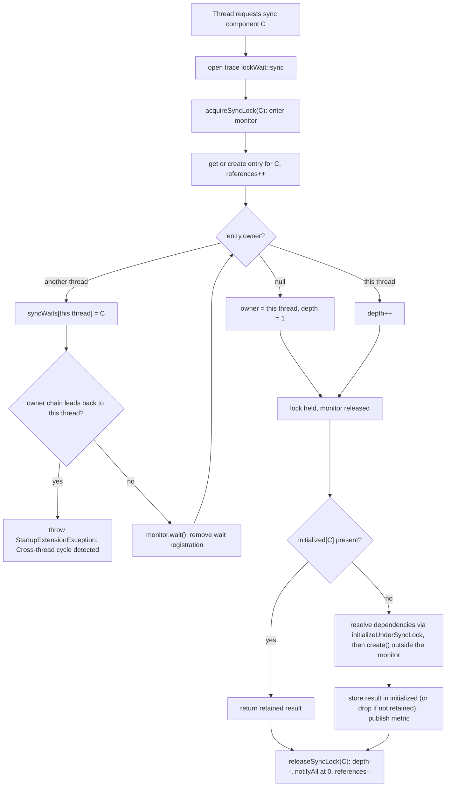
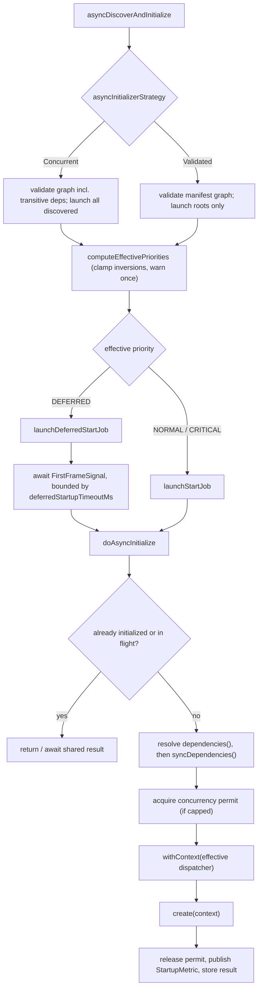

# Architecture: how it works internally

This document describes how `app-startup-extension` discovers, orders and runs initializers, and
which guarantees it gives about threads, concurrency and errors in 3.0. It is derived from the code in
`core/src/main/kotlin`; types marked *internal* are implementation details and are not part of the public
API (see the [API reference](api-reference.md) for the public surface).

## Table of contents

1. [Overview](#1-overview)
2. [Components](#2-components)
3. [Startup sequence](#3-startup-sequence)
4. [Dependency resolution](#4-dependency-resolution)
5. [Threading model (3.0)](#5-threading-model-30)
6. [Async execution](#6-async-execution)
7. [State ownership and thread-safety notes](#7-state-ownership-and-thread-safety-notes)
8. [Awaiting startup](#8-awaiting-startup)
9. [Metrics and tracing](#9-metrics-and-tracing)
10. [Error handling](#10-error-handling)
11. [R8 / consumer rules](#11-r8--consumer-rules)

---

## 1. Overview

The library extends AndroidX App Startup with two kinds of initializers:

- `StartupSyncInitializer<T>`: a blocking `create(context): T`. The caller is blocked until it returns.
- `StartupAsyncInitializer<T>`: a `suspend create(context): T`, run on a coroutine scope owned by the library.

Initializers are declared as `<meta-data>` entries of `InitializationProvider` in the manifest (value
`sync-initializer` or `async-initializer`). At process start the provider triggers discovery, runs the
synchronous initializers, and launches the asynchronous ones without waiting for them. Application code
later awaits the asynchronous work with `awaitAllStartJobs()` / `onAppStartupLaunched { }`, or requests
individual components on demand with `initializeComponent()` / `doInitialize()`.

## 2. Components

`AppStartupInitializer` is a facade (singleton, obtained with `AppStartupInitializer.getInstance(context)`).
Since the extraction refactor it owns the shared state and delegates the work to the collaborators below.
All collaborators except the facade, the config types and the public value types are `internal`.

| Component | Responsibility |
|---|---|
| `InitializationProvider` (public) | `ContentProvider` started by Android; its `onCreate()` calls `AppStartupInitializer.getInstance(context).discoverAndInitialize(...)`. All data operations throw `IllegalStateException("Not allowed.")`. |
| `AppStartupInitializer` (public facade) | Singleton entry point. Owns the `initialized` map, the discovered-class sets, the registry, the metrics bus and the engine; exposes `initializeComponent`, `doInitialize`, `metricsFlow`, `dispatcherSnapshots` and the `configure` companion function. |
| `StartupPlanner` | Pure planning: Kahn topological sort of sync initializers, async graph validation and root detection, effective-priority resolution (priority inversion clamp). Launches nothing. |
| `SyncRunner` | Synchronous pipeline: discovery of sync classes from manifest metadata, depth-first dependency-first initialization, StrictMode policy, metric publication. |
| `AsyncRunner` | Asynchronous pipeline: discovery of async classes, root launching (eager and first-frame-gated deferred), dependency-first suspending initialization, in-flight de-duplication, permit/dispatcher handling, metric publication. |
| `SyncLockCoordinator` | Per-component re-entrant ownership with cross-thread wait-cycle detection, guarded by a single monitor held only while claiming, waiting or releasing. |
| `AppStartupCoroutinesEngine` | `CoroutineScope` backed by a `SupervisorJob`; tracks start jobs and deferred start jobs, the `StartupState` flow, the active-async counter and the optional concurrency `Semaphore`. |
| `InitializerRegistry` | Sole owner of reflective construction (`getDeclaredConstructor().newInstance()`); `peek` caches without consuming (graph passes), `take` hands the instance over (execution), so each class is instantiated once per startup. |
| `StartupMetricsBus` | Bounded hot `MutableSharedFlow<StartupMetric>` (`replay = capacity`, `DROP_OLDEST`); `publish` never suspends. |
| `StartupTracer` / `SystemStartupTracer` | Tracing seam over `android.os.Trace` (sync sections, async sections, counters, zero-length markers). `StartupTraceNames` builds the `Startup::<phase>::<FQN>` names. |
| `DispatcherInstrumentation` / `InstrumentedDispatcher` | Opt-in measuring wrapper around each initializer's effective dispatcher; feeds `dispatcherSnapshots()`. |
| `AndroidFirstFrameSignal` | Default `FirstFrameSignal`: completes when the first created activity's decor view draws. Created lazily, only if a `DEFERRED` root exists. |
| `StartupExtensionLogger` | Debug logger (`Log.i/w/e`, tag `StartupLogger`), no-op unless `debugLoggingEnabled` is `true`; messages are built lazily. |

## 3. Startup sequence

1. Android creates `InitializationProvider` on the **main thread** during process start and calls `onCreate()`.
2. `onCreate()` calls `AppStartupInitializer.getInstance(context)`. The first call constructs the singleton
   (double-checked locking), which creates the engine (using the *current* `maxConcurrentAsyncInitializers`)
   and the metrics bus (using the *current* `metricsReplayCapacity`), then calls `discoverAndInitialize`.
3. `discoverAndInitialize` reads the provider's metadata with `PackageManager.getProviderInfo(...,
   GET_META_DATA)` (a blocking IPC call, traced as `Startup::getProviderInfo`). A provider with no
   `<meta-data>` yields an empty bundle, so nothing runs. A missing provider entry raises
   `StartupExtensionException`.
4. `SyncRunner.syncDiscoverAndInitialize(metadata)` keeps every key whose value is `sync-initializer`, loads
   the class with `Class.forName(key, false, classLoader)` (a `ClassNotFoundException` becomes
   `StartupExtensionException`; classes that are not `StartupSyncInitializer` are silently ignored), orders
   them according to `syncOrderingStrategy`, and initializes them one after another **on the calling (main)
   thread**.
5. `AsyncRunner.asyncDiscoverAndInitialize(metadata)` does the same for `async-initializer` keys, validates
   the graph according to `asyncInitializerStrategy`, resolves effective priorities, then **launches** the
   roots on the engine and returns immediately. `onCreate()` does not wait for async work.
6. Later, application code awaits the launched jobs (see [Awaiting startup](#8-awaiting-startup)).

## 4. Dependency resolution

**Declaring dependencies.** `StartupSyncInitializer.dependencies()` lists sync classes.
`StartupAsyncInitializer.dependencies()` lists async classes, and `StartupAsyncInitializer.syncDependencies()`
lists sync classes that must finish before the async `create()` runs. The two async lists make the
dependency model mixed (async depends on async and on sync); a sync initializer can only depend on sync ones.

**Sync ordering** (`syncOrderingStrategy`):

- `Lazy` (default): initializers are processed in discovery order; each one initializes its not-yet-initialized
  dependencies depth-first before its own `create()`. A cycle is found mid-initialization, after some
  `create()` calls may have run.
- `Topological`: `StartupPlanner.topologicalSort` runs Kahn's algorithm over the discovered set before any
  `create()`. Remaining nodes after the sort form a cycle and raise `StartupExtensionException` naming them
  (`Cycle detected in sync initializers: [...]`). Dependencies that are not in the discovered set are not
  edges of this graph; they are still resolved depth-first when their dependent runs.

**Async validation and launch** (`asyncInitializerStrategy`):

- `Concurrent` (default): the graph (including transitive dependencies absent from the manifest) is validated
  up front with Kahn's algorithm (trace `Startup::resolveGraph::validateConcurrent`), then **every**
  discovered async initializer gets its own coroutine. Shared dependencies are de-duplicated at runtime.
- `Validated`: only manifest-declared nodes are validated (`Startup::resolveGraph::validateRoots`); only
  **roots** (async initializers that no other discovered async initializer depends on) are launched.
  Their dependencies are resolved recursively inside the root's coroutine.
- In both cases `syncDependencies()` are *not* part of the validated async graph. A cycle raises
  `StartupExtensionException` (`Cycle detected in async initializers: [...]`) from the provider before any
  coroutine is launched.

**Runtime cycle detection.** Both runners also carry an `initializing` set per dependency chain
(`Cannot initialize <FQN>. Cycle detected.`), which is the only safeguard for cycles through dependencies
that the up-front passes do not see (for example, in `Lazy` sync ordering).

**Cross-thread sync cycles.** Two threads can each own a sync initializer and then wait for the other's.
`SyncLockCoordinator` records which component each blocked thread waits for and, before blocking, walks the
owner chain; if it leads back to the waiting thread it throws
`StartupExtensionException("Cannot initialize <FQN>. Cross-thread cycle detected.")` instead of
deadlocking. Only waits that go through the coordinator are visible: a thread blocked on something outside
the library (for example a worker waiting for the main thread while main waits on that worker's initializer)
cannot be detected (see the [migration guide](migration-3.0.md)).

**Mixed dependencies at runtime.** For an async initializer, `deps` are resolved first (sequentially, each
through `doAsyncInitialize`), then `syncDependencies` through `SyncRunner.initializeUnderSyncLock` in the
current coroutine context, and only then the concurrency permit is requested and `create()` is dispatched.

## 5. Threading model (3.0)

**Sync initializers run on the requesting thread.** `create()` is not posted to the main thread anymore.
The caller stays blocked until it completes.

| Entry point | Thread that runs `create()` |
|---|---|
| Provider-driven startup (manifest `sync-initializer`) | Main thread, because Android calls `InitializationProvider.onCreate()` there |
| `initializeComponent()` / `doInitialize()` (non-suspend) | The calling thread |
| `StartupAsyncInitializer.syncDependencies()` | The thread running the async initializer's coroutine at that point: the engine dispatcher (`Dispatchers.Default`) for startup-driven work, or the caller's context for on-demand `doInitialize` |

**Per-component coordination instead of a global lock.** `SyncLockCoordinator` keeps one entry per component
(`owner`, re-entrancy `depth`, `references`) under a single monitor. The monitor is held only to claim, wait
for or release ownership; `create()` and dependency work run outside it. Consequences:

- Unrelated components initialize concurrently on different threads.
- The owner thread can re-enter its own component (depth counter), which lets the `initializing` set report
  same-thread cycles with a clear message instead of deadlocking.
- Entries are reference-counted and removed when no thread holds or awaits them.
- An interrupt while waiting restores the interrupt flag and throws `IllegalStateException`.

**Same-component requests share one result.** After acquiring a component's lock, `SyncRunner` first checks
`initialized[component]`; a second thread that waited for an in-flight `create()` therefore receives the
retained result without running `create()` again. This holds for retained results. For
`retainAfterStartup() == false` the value is removed once initialization finishes, so a later request runs
`create()` again.

## 6. Async execution

**Scope and isolation.** `AppStartupCoroutinesEngine` is a `CoroutineScope` whose context is
`SupervisorJob() + dispatcher` (`Dispatchers.Default` for the singleton). Each root is an `async` child, so a
failing initializer does **not** cancel its siblings. Failures stay inside the `Deferred` and surface when
the jobs are awaited.

**Dispatcher per instance.** The dispatcher that runs `create()` is resolved as: non-null
`StartupAsyncInitializer.dispatcher()` > `AppStartupConfig.defaultAsyncDispatcher` > `Dispatchers.Default`.
`create()` runs inside `withContext(effectiveDispatcher)`. With `dispatcherInstrumentationEnabled`, that
dispatcher is first wrapped (once per distinct dispatcher) in `InstrumentedDispatcher`.

**Concurrency permits.** `maxConcurrentAsyncInitializers = n` (values `<= 0` mean unbounded) creates a
`Semaphore(n)` in the engine. A permit is acquired **after** dependencies are resolved and held across the
dispatch and the `create()` body, then released in `finally`. Because a parent never holds a permit while
waiting for a child's permit, a cap of 1 cannot deadlock on dependency chains. Time spent waiting is
reported as `permitWaitMs`; `queueDelayMs` covers permit wait plus dispatcher scheduling.

**Priorities and the first-frame gate.** After graph validation, `computeEffectivePriorities` determines each
node's effective priority, and the roots to launch are partitioned:

- `NORMAL` and `CRITICAL` roots (eager) launch immediately via `launchStartJob`. `CRITICAL` currently
  behaves exactly like `NORMAL`.
- `DEFERRED` roots launch via `launchDeferredStartJob`. Each first awaits the `FirstFrameSignal`
  (`config.firstFrameSignal`, else a lazily created `AndroidFirstFrameSignal`) inside
  `withTimeoutOrNull(deferredStartupTimeoutMs)`, records a `deferredSignal` or `deferredTimeout` marker, and
  then runs the normal initialization. No permit is held while waiting for the signal. Deferred jobs are
  tracked separately from start jobs, so `awaitAllStartJobs()` never waits for them.

**Priority inversion.** If an eager initializer depends (transitively) on a `DEFERRED` one, the dependency's
effective priority is clamped up to the most eager dependent so the eager dependent is not stranded behind
the first frame. A single warning is logged per startup with `Log.w` (tag `StartupLogger`, not gated by
`debugLoggingEnabled`) and a `Startup::marker::priorityInversion::<FQN>` marker is emitted.

**De-duplication and retention.** Concurrent requests for the same async component share one
`CompletableDeferred` (`asyncInFlight`). Retained results go to the shared `initialized` map. For
`retainAfterStartup() == false`, results produced by the startup graph are kept in a transient map only while
startup roots are pending, so sibling dependents reuse them; the map is cleared when the last root finishes.

## 7. State ownership and thread-safety notes

| State | Owner | Notes |
|---|---|---|
| `config` (static) | `AppStartupInitializer` companion, `@Volatile` | Replaced atomically by `configure`. Runners read it on every use, so later calls win, **except** `maxConcurrentAsyncInitializers` and `metricsReplayCapacity`, which are read when the singleton is constructed. Call `configure` before the provider runs (for example in `Application.attachBaseContext`). |
| `initialized` | Facade, `ConcurrentHashMap<Class, Any>` | Shared by reference with both runners. Holds retained results. |
| `syncDiscovered`, `asyncDiscovered` | Facade, `CopyOnWriteArraySet` | Back `isEagerlySyncInitialized` / `isEagerlyAsyncInitialized`. |
| Sync lock entries and wait map | `SyncLockCoordinator`, one monitor | Never held during `create()`. |
| `asyncInFlight`, transient components, pending-root counter, strict-mode warn flag | `AsyncRunner` | Concurrent collections and atomics. |
| Start jobs, deferred jobs, active counter, semaphore, `StartupState` | `AppStartupCoroutinesEngine` | Synchronized lists, atomics, `MutableStateFlow`. |
| Instances | `InitializerRegistry`, `ConcurrentHashMap` | `peek` is atomic per class. |

Further notes:

- On-demand async calls (`suspend doInitialize`) take a single `Mutex` for the whole call; they are
  serialized with each other. Startup-driven async work does not use this mutex.
- `metricsFlow` is bounded: late collectors get the last `metricsReplayCapacity` metrics, and slow live
  collectors lose the oldest ones (`DROP_OLDEST`). `publish` never suspends.
- `metricsFlow` is a hot flow on a process-lifetime singleton: a collector that captures an `Activity` keeps it
  alive for as long as the collection runs, so collect from a lifecycle-aware scope.
- A custom `FirstFrameSignal` stored in `AppStartupConfig` lives for the whole process and must not retain
  an `Activity` or `Fragment`.
- Sync initializers run with no timeout; heavy work on the provider path blocks main and risks an ANR.

## 8. Awaiting startup

- `AppStartupInitializer.awaitAllStartJobs()` suspends until every non-deferred start job completes, then sets
  `StartupState.COMPLETED`. If a job failed, `awaitAll` throws the first failure and the state becomes `ERROR`
  (`ERROR` is sticky: a later `COMPLETED` does not overwrite it).
- `awaitAllStartJobs(timeoutMs)` wraps the await in `withTimeout`. On timeout (or any cancellation) it cancels
  start jobs that are still active and rethrows (`TimeoutCancellationException` on timeout).
- `onAppStartupLaunched { }` is `awaitAllStartJobs()` followed by the block.
- `isAllStartedJobsDone()` is a non-suspending check: no tracked start job is active (deferred jobs are not
  tracked here).
- `startupState` is a `StateFlow<StartupState>`: `IDLE`, then `IN_PROGRESS` when the first eager job launches,
  then `COMPLETED` or `ERROR` **when `awaitAllStartJobs` runs** (jobs finishing alone do not change it). A
  startup with only `DEFERRED` roots never leaves `IDLE`.
- Start jobs are cleared after an await only once all of them are terminal, so failed jobs stay observable
  while siblings are still running.

## 9. Metrics and tracing

**Metrics.** Each execution publishes one `StartupMetric` to the bus when it finishes, successfully or not.
Sync metrics carry name, FQN, duration, timestamps, process offset and error strings; async metrics also
carry dispatcher label, thread, concurrency snapshot, `queueDelayMs`, `permitWaitMs`, priority (the *declared*
priority) and `wasCancelled`. Only error type and message strings are kept, never the `Throwable`. See
[`StartupMetric`](api-reference.md#startupmetric).

**Tracing.** All instrumentation goes through `StartupTracer`, which in production is `SystemStartupTracer`
over `android.os.Trace`. Sections are named `Startup::<phase>::<FQN>` (capped at 127 characters; the FQN is
shortened from the left). Sync sections are used for blocks that cannot suspend; blocks that can suspend use
async slices so begin/end pair across thread hops. Below API 29 only sync sections are emitted; async
slices and counters are no-ops. Counters (`Startup::activeAsync`, `Startup::permitsWaiting`,
`Startup::permitsAvailable`, `Startup::busSize`) and zero-length markers (state transitions, `cancel`,
`priorityInversion`, `strictModeConcurrency`, `deferredSignal`/`deferredTimeout`) never alter behavior and are
skipped when tracing is disabled. The tracer interface is internal; the section names are the observable
contract. The full list is in [Observability](observability.md#trace-sections).

**Dispatcher instrumentation.** Opt-in and debug-only. See
[`DispatcherSnapshot`](api-reference.md#dispatchersnapshot).

## 10. Error handling

| Situation | Behavior |
|---|---|
| Sync `create()` throws during provider startup | Wrapped in `StartupExtensionException`, propagates out of `ContentProvider.onCreate()` and is fatal for the process. A metric with `success = false` is published first. The component is not stored, so a later request retries it. |
| Sync `create()` throws on demand | `StartupExtensionException` thrown to the caller. |
| Async `create()` throws | Wrapped in `StartupExtensionException` (logged when debug logging is on). The job fails in isolation; siblings continue (`SupervisorJob`). The error surfaces from `awaitAllStartJobs()` and sets `StartupState.ERROR`. If nobody awaits, nothing crashes. |
| Async initializer cancelled | `CancellationException` is rethrown unwrapped; the metric has `wasCancelled = true` and `success = false`. |
| Failing `DEFERRED` job | Never awaited, so it never crashes the process and never reaches `awaitAllStartJobs()`. |
| Cycle in a validated graph | `StartupExtensionException` listing the participating simple class names, before any coroutine launch (async) or any `create()` (sync, `Topological`). |
| Cross-thread sync cycle | `StartupExtensionException` ("Cross-thread cycle detected"). |
| Class in manifest not found | `StartupExtensionException` wrapping `ClassNotFoundException`. |
| Abstract class or interface used as initializer | `StartupExtensionException` ("expected a concrete class"). |
| Provider not found in manifest | `StartupExtensionException` wrapping `NameNotFoundException`. |
| Priority inversion | Clamp plus one `Log.w` warning; not an error. |
| Strict-mode concurrency threshold exceeded | One warning per startup, emitted through the debug logger, so it needs both `strictModeCheckEnabled` and `debugLoggingEnabled`. |

With `strictModeCheckEnabled`, each sync `create()` runs under a thread `StrictMode` policy
(`detectAll().penaltyLog()`) and the previous policy is restored afterwards, on the thread that runs it.

## 11. R8 / consumer rules

Initializers are located by class name in manifest metadata and created reflectively with the no-argument
constructor, so R8 cannot trace them. `core/consumer-rules.pro` ships with the library and keeps:

- every class implementing `StartupSyncInitializer`, with its `<init>()`;
- every class implementing `StartupAsyncInitializer`, with its `<init>()`;
- `io.github.santimattius.android.startup.InitializationProvider`, which is registered in the manifest by
  name.

Initializers therefore need a public no-argument constructor and a stable class name; the manifest provider
entry declares `android:authorities="${applicationId}.app-startup-extension"` and `android:exported="false"`.
