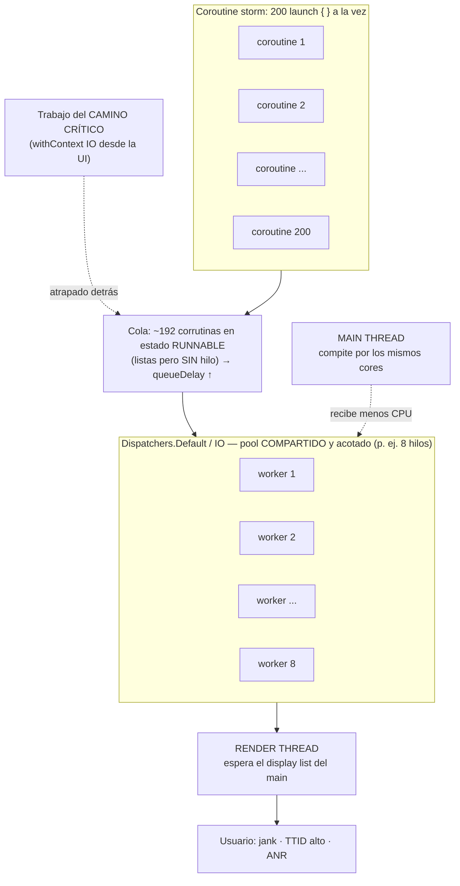

# Coroutine Storm: cuando lanzar corrutinas de más degrada toda la app

*Borrador de artículo técnico para la comunidad. Enfocado en el arranque (startup) de aplicaciones Android/JVM, pero aplicable a cualquier código basado en Kotlin Coroutines.*

> **TL;DR**
> Un *coroutine storm* es lanzar un número desproporcionado de corrutinas al mismo tiempo contra un pool de hilos **compartido y acotado** (`Dispatchers.Default`, `Dispatchers.IO`). Como esos dispatchers son **singletons de proceso**, la tormenta no queda "contenida" donde ocurre: satura el pool para **toda** la aplicación, le roba tiempo de CPU al **hilo principal**, y el usuario lo siente como **arranque lento, jank y ANR**. Sí, una tormenta lanzada en cualquier parte de la app puede degradar pantallas y flujos que no tienen nada que ver con ella.

---

## 1. Qué es un "coroutine storm"

Lanzar una corrutina es barato. Lanzar *diez mil* corrutinas que quieren correr **a la vez** no lo es.

Una corrutina no ejecuta en el vacío: necesita un **hilo** para correr su cuerpo. Ese hilo lo entrega un `CoroutineDispatcher`. Y los dispatchers "de fábrica" están respaldados por pools de hilos **finitos**:

| Dispatcher | Paralelismo real (por defecto) | Uso correcto |
|---|---|---|
| `Dispatchers.Default` | `max(2, nº de cores)` | Trabajo **CPU-bound** (parsing, mapeos, cálculo) |
| `Dispatchers.IO` | 64 hilos (o nº de cores si es mayor) | Trabajo **bloqueante**: disco, red, DB |
| `Dispatchers.Main` | 1 (el hilo de UI) | UI, orquestación ligera |

Puntos clave que hacen posible la tormenta:

1. **Son pools acotados.** En un teléfono de 8 cores, `Default` corre ~8 corrutinas CPU-bound a la vez. `IO` admite hasta 64 llamadas bloqueantes simultáneas.
2. **`Default` e `IO` comparten el mismo pool elástico** de hilos por debajo. `IO` puede crecer hasta su límite, pero no vive en un universo aparte.
3. **Son singletons de proceso.** Hay *un* `Dispatchers.Default` y *un* `Dispatchers.IO` para **toda** la aplicación: tu código, tus librerías, tus SDKs de terceros, el decodificado de imágenes, la capa de red… todos comparten los mismos hilos.
4. **Todo compite por los mismos cores físicos.** Aun el hilo principal (`Main`) es *un hilo del sistema operativo más* que pelea por CPU contra los 8, 16 o 64 hilos worker que la tormenta despertó.

Cuando lanzás más corrutinas *listas para correr* de las que el pool puede atender, el resto no desaparece: **se encola**. Ese tiempo "listo pero esperando un hilo" es el corazón del problema.

> **La señal que importa: `queueDelay`.** No es cuánto tarda tu tarea en ejecutarse, sino **cuánto espera desde que está lista para correr hasta que realmente arranca**. En un pool saturado, `queueDelay` se dispara aunque cada tarea individual sea rápida.

---

## 2. Por qué el startup es el epicentro perfecto

El arranque concentra todos los ingredientes para la tormenta:

- **Todo quiere ejecutarse "ya".** App Startup / inicializadores, el grafo de DI, SDKs de analytics, crash reporting, remote config, feature flags, precarga de caches… todo se dispara en la misma ventana de tiempo.
- **El patrón dominante es "dispará y olvidá".** Es tentador resolver cada inicialización pesada con un `scope.launch(Dispatchers.IO) { … }` por componente. Con 30–40 inicializadores, ya estás lanzando 30–40 corrutinas que compiten por el mismo pool en el segundo más caliente del proceso.
- **El disco está frío.** En cold start las cachés del sistema de archivos están vacías: cada lectura tarda más, cada hilo de `IO` se retiene más tiempo, y por lo tanto **más corrutinas se encolan** esperando un permiso de ejecución.
- **El main thread está en el camino crítico.** El primer frame, la primera pantalla y —en Android— el `ContentProvider`/`Application`/primera `Activity` corren en el hilo principal. Cualquier trabajo que le robe CPU en ese instante retrasa lo que el usuario **ve**.

El resultado típico: **Time To Initial Display (TTID) alto, jank en la primera pantalla y, en el peor caso, ANR** — no porque una tarea sea lenta, sino porque cientos de tareas rápidas se pisan entre sí.

---

## 3. La mecánica del daño

Visualmente, una tormenta se ve así: muchas más corrutinas *listas para correr* que hilos disponibles, una cola que crece (`queueDelay`), y el hilo principal peleando por los mismos cores.



Una tormenta hace daño por varios frentes a la vez:

### 3.1 Saturación del pool y encolado (`queueDelay`)
Si hay 8 hilos en `Default` y lanzás 200 tareas CPU-bound, 192 esperan. La tarea #193 puede ser trivial, pero no arranca hasta que se libere un hilo. Tu trabajo del **camino crítico** queda detrás de trabajo diferible.

### 3.2 Sobre-suscripción y context switching
Si además metés trabajo **bloqueante** en `Default` (mala práctica), los pocos hilos CPU quedan tomados durmiendo en I/O. El scheduler no puede avanzar el trabajo de CPU real y el sistema pierde tiempo en cambios de contexto en lugar de progreso útil.

### 3.3 Presión de memoria y GC
Cada corrutina retiene su marco de continuación y **todo lo que captura** (contextos, callbacks, buffers). Miles de corrutinas simultáneas = miles de objetos vivos + allocations justo en el momento de mayor presión de memoria del proceso. Más GC → más pausas → más jank.

### 3.4 Contención de recursos compartidos aguas abajo
El pool no es el único cuello de botella. La tormenta lo traslada a:
- **SQLite / Room**: un único *writer*. 50 escrituras concurrentes se serializan igual, pero ahora con 50 hilos bloqueados esperando.
- **DataStore / SharedPreferences**, el cabezal del disco, el *connection pool* de OkHttp (`Dispatcher.maxRequests`), locks de tu propio código…

La concurrencia "de mentira" (lanzar todo junto) no acelera un recurso intrínsecamente secuencial; solo agrega hilos bloqueados y latencia de encolado.

### 3.5 Inanición indirecta del hilo principal
El más subestimado, y el que más se nota. Lo desarrollamos entero en la sección 5.

---

## 4. La pregunta clave: ¿una tormenta en otra parte degrada toda la app?

**Sí, y es la consecuencia más importante de entender.**

El error mental común es asumir aislamiento:

> *"Lo lanzo en un dispatcher de background, así que no afecta al resto."*

Es **falso**. `Dispatchers.Default` y `Dispatchers.IO` son **recursos globales del proceso**. Una tormenta en la feature X no compite solo consigo misma: compite con **todo lo demás que use esos mismos dispatchers**, incluida la UI.

### Ejemplo 1 — Sync en background que arruina el scroll
El usuario scrollea una lista con imágenes. La librería de imágenes decodifica en `Dispatchers.Default`. En ese momento, una sincronización en background dispara:

```kotlin
// En algún ViewModel / worker, lejos de la UI
items.forEach { item ->
    scope.launch(Dispatchers.IO) {   // 500 corrutinas de golpe
        repository.sync(item)
    }
}
```

`IO` se llena (tope 64), y como comparte pool elástico con `Default`, la decodificación de imágenes empieza a encolarse. Resultado: **frames perdidos en una pantalla que no tiene ninguna relación con la sincronización.**

### Ejemplo 2 — Fan-out durante el startup
40 inicializadores async lanzados a la vez saturan el pool. La primera pantalla necesita leer un flag (`withContext(IO)`) para decidir qué mostrar: ese read queda detrás de los 40 y el **TTID** sube aunque el read en sí tome 2 ms.

**Conclusión:** el radio de impacto de una tormenta **no es el módulo donde ocurre**; es **todo el proceso**.

---

## 5. Dónde lo siente el usuario: Main Thread, Compose y Render Thread

Acá está el corazón de por qué esto importa: la tormenta corre en hilos de *background*, pero **el daño emerge en el pipeline de renderizado**, que es lo único que el usuario percibe.

### 5.1 El presupuesto de frame (la regla de oro)
Para que la UI se sienta fluida, cada frame debe producirse dentro de su presupuesto:

| Refresco de pantalla | Presupuesto por frame |
|---|---|
| 60 Hz | ~16,6 ms |
| 90 Hz | ~11,1 ms |
| 120 Hz | ~8,3 ms |

Si el trabajo de un frame no termina a tiempo, ese frame **se pierde** (*dropped/janky frame*) y el usuario ve un tirón. Perder muchos frames seguidos = scroll trabado. Si el hilo principal no responde a un input en ~5 s = **ANR**.

### 5.2 El pipeline de un frame (simplificado)
```
Input / animación
      │
      ▼
[ MAIN THREAD (UI thread) ]
   • recomposición (Compose) / measure + layout + draw (record)
   • ejecuta también tus coroutines de UI (Dispatchers.Main)
      │  produce el display list
      ▼
[ RENDER THREAD ]
   • rasteriza en la GPU a partir del display list
      │
      ▼
   Frame en pantalla
```

Dos ideas centrales:
1. **El RenderThread depende del Main Thread.** El RenderThread solo puede dibujar lo que el hilo principal ya *grabó* (el display list). Si el main thread llega tarde con ese trabajo, el RenderThread no tiene nada que rasterizar a tiempo → frame perdido, por más que la GPU esté libre.
2. **El Main Thread no está aislado del pool.** Es un hilo del SO que compite por los mismos cores que los hilos worker. Una tormenta CPU-bound en `Default` **le roba ciclos al hilo principal a nivel de scheduler del SO**, aunque tu código nunca "bloquee" el main thread de forma explícita.

### 5.3 Cómo la tormenta ataca cada pieza

**Main Thread — dos vías de daño:**
- **Robo de CPU (indirecto):** la tormenta despierta N hilos worker que pelean por los cores. El hilo principal recibe menos tiempo de CPU, la recomposición/layout tarda más, y se pierde el deadline del frame.
- **Suspensión esperando background:** el flujo de UI casi siempre hace `withContext(IO/Default) { … }` y **espera** (leer una preferencia, un archivo, un mapeo). Si ese `withContext` no consigue hilo porque el pool está saturado, la corrutina de UI queda suspendida → la pantalla no avanza.

**Jetpack Compose — un detalle crítico:**
`LaunchedEffect`, `rememberCoroutineScope()` y `produceState` heredan el `CoroutineContext` de la composición, que en Android está atado a **`AndroidUiDispatcher.Main`** (sincronizado con el frame clock / `Choreographer`). Es decir: **por defecto corren en el hilo principal.**

- Si lanzás trabajo pesado dentro de un `LaunchedEffect` sin cambiar de dispatcher, ese trabajo corre **en el main thread** y compite frame a frame.
- La **recomposición** también ocurre en el main thread. Trabajo pesado dentro del cuerpo `@Composable` (o en un `remember` mal usado) se ejecuta en cada recomposición y se come el presupuesto de frame.
- Actualizaciones frecuentes de `State` desde una tormenta (p. ej. muchos flows emitiendo a la vez) disparan **avalanchas de recomposición**, que también son trabajo del hilo principal.

**Render Thread:**
No lo saturás con corrutinas directamente, pero lo dejás "esperando" cuando el main thread llega tarde con el display list. Además compite por CPU/GPU con todo lo demás. Un main thread hambriento se traduce en un RenderThread ocioso que no puede cumplir el deadline.

### 5.4 Qué ve el usuario
- **Cold start más largo:** pantalla en blanco / splash congelado (TTID alto), primer contenido útil tardío (TTFD alto).
- **Jank:** scroll a tirones, animaciones que "saltan", transiciones no fluidas.
- **Input laggy:** taps que responden tarde.
- **ANR:** el diálogo "La app no responde" si el main thread queda sin CPU o bloqueado demasiado tiempo.
- **Batería y calor:** decenas de hilos girando en el peor momento.

---

## 6. Cómo detectarlo: herramientas

No optimices a ciegas: **observá primero, acotá después.**

### 6.1 En el timeline (lo más revelador)
- **Perfetto / System Tracing:** la herramienta más potente. Mirá los estados de los hilos: un hilo en **`Runnable`** (listo pero sin CPU) mucho tiempo es *la firma de la tormenta* a nivel de SO (el equivalente del `queueDelay`). Etiquetá tus secciones con un prefijo estable (p. ej. `Startup::MiInit`) para verlas en el timeline.
- **Android Studio Profiler (CPU / Threads):** muestra la línea de tiempo de hilos; se ve el enjambre de `DefaultDispatcher-worker-*` peleando por slots mientras el `main` se estira.

### 6.2 Métricas de arranque y de frames
- **Jetpack Macrobenchmark:** `StartupTimingMetric` (TTID/TTFD) y `FrameTimingMetric` (frames lentos) de forma reproducible en CI.
- **JankStats** (`androidx.metrics:metrics-performance`): reporta frames con jank *en producción* y permite adjuntar "estado" (qué pantalla/acción) al frame problemático.
- **`adb shell dumpsys gfxinfo <package>`:** porcentaje de janky frames e histograma de tiempos (percentiles 50/90/95/99).
- **Play Console — Android Vitals** y **Firebase Performance:** datos de campo: tasa de ANR, cold start lento, *frozen frames*.

### 6.3 Cazando trabajo indebido en el main thread
- **Logcat / Choreographer:** el clásico `Skipped NN frames! The application may be doing too much work on its main thread.`
- **StrictMode** (en debug): detecta I/O de disco/red en el hilo principal.

```kotlin
if (BuildConfig.DEBUG) {
    StrictMode.setThreadPolicy(
        StrictMode.ThreadPolicy.Builder()
            .detectDiskReads().detectDiskWrites().detectNetwork()
            .penaltyLog()
            .build()
    )
}
```

### 6.4 Herramientas específicas de coroutines
- **Nombres de hilo / dispatcher reales:** registrá en qué hilo corrió cada tarea (`Thread.currentThread().name`). Si todo cayó en los mismos worker, hay contención.
- **`kotlinx-coroutines-debug`:** `DebugProbes.install()` + `DebugProbes.dumpCoroutines()` para ver cuántas corrutinas hay vivas y dónde están suspendidas. Corré la JVM con `-ea -Dkotlinx.coroutines.debug`.
- **Panel de Coroutines del debugger de Android Studio:** inspección de corrutinas activas y su estado.

### 6.5 Específico de Compose
- **Layout Inspector → recomposition counts:** detecta recomposiciones excesivas (síntoma de tormenta de estado o de trabajo pesado en composición).
- **Reportes del compilador de Compose** (stability/skippability): ayudan a reducir recomposiciones innecesarias.

### 6.6 Instrumentación propia
Medí y exponé **`queueDelay`** y **concurrencia pico** para tus tareas. En esta librería, `StartupMetric` ya expone `queueDelayMs`, `concurrentActiveCount`, `dispatcherName` y `threadName` justamente para *ver* la tormenta antes de decidir si hace falta acotarla.

---

## 7. Galería de malas y buenas prácticas

### 7.1 Fan-out sin límite

**❌ Malo** — una corrutina por ítem, todas a la vez, en `GlobalScope`:
```kotlin
fun preloadEverything(items: List<Item>) {
    items.forEach { item ->
        GlobalScope.launch(Dispatchers.IO) {   // sin ciclo de vida ni cupo
            cache.put(item.id, readFromDisk(item))
        }
    }
}
```

**✅ Bueno** — concurrencia estructurada + cupo explícito:
```kotlin
suspend fun preloadEverything(items: List<Item>) = coroutineScope {
    val gate = Semaphore(permits = 4)
    items.forEach { item ->
        launch(Dispatchers.IO) {
            gate.withPermit { cache.put(item.id, readFromDisk(item)) }
        }
    }
}
```
*Por qué:* el `Semaphore` acota el pico que satura el pool global; el `coroutineScope` da cancelación y ciclo de vida.

### 7.2 Dispatcher equivocado

**❌ Malo** — I/O bloqueante robando hilos de CPU:
```kotlin
withContext(Dispatchers.Default) { file.readBytes() }   // bloqueante en Default
```

**✅ Bueno** — cada trabajo en su pool:
```kotlin
withContext(Dispatchers.IO) { file.readBytes() }        // I/O en IO
withContext(Dispatchers.Default) { parseAndMap(bytes) } // CPU en Default
```

### 7.3 `LaunchedEffect` con trabajo pesado (corre en Main)

**❌ Malo** — el trabajo corre en el hilo principal y clava el frame:
```kotlin
@Composable
fun Screen(id: String) {
    var data by remember { mutableStateOf<Data?>(null) }
    LaunchedEffect(id) {
        data = repository.loadHeavy(id)   // ⚠️ por defecto: Dispatchers.Main
    }
}
```

**✅ Bueno** — el trabajo pesado se mueve fuera del main:
```kotlin
@Composable
fun Screen(id: String) {
    var data by remember { mutableStateOf<Data?>(null) }
    LaunchedEffect(id) {
        data = withContext(Dispatchers.IO) { repository.loadHeavy(id) }
    }
}
```
*Mejor aún:* que el trabajo viva en el `ViewModel` y la UI observe estado; el `Composable` solo recolecta.

### 7.4 Cálculo pesado en recomposición

**❌ Malo** — se recalcula en cada recomposición, en el main thread:
```kotlin
@Composable
fun Total(items: List<Item>) {
    val total = items.sumOf { it.expensiveScore() } // corre en cada recompose
    Text("$total")
}
```

**✅ Bueno** — cacheado y desacoplado del ritmo de recomposición:
```kotlin
@Composable
fun Total(items: List<Item>) {
    val total by remember(items) {
        derivedStateOf { items.sumOf { it.expensiveScore() } }
    }
    Text("$total")
}
```

### 7.5 Colección de flows sin ciclo de vida

**❌ Malo** — sigue recolectando (y recomponiendo) en background, desperdiciando recursos:
```kotlin
val state by viewModel.state.collectAsState()
```

**✅ Bueno** — respeta el ciclo de vida:
```kotlin
val state by viewModel.state.collectAsStateWithLifecycle()
```
Y en Vistas clásicas:
```kotlin
lifecycleScope.launch {
    repeatOnLifecycle(Lifecycle.State.STARTED) {
        viewModel.state.collect { render(it) }
    }
}
```

### 7.6 `runBlocking` en el arranque / main thread

**❌ Malo** — bloquea el hilo principal (ANR asegurado si hay I/O):
```kotlin
override fun onCreate() {
    val config = runBlocking { remoteConfig.fetch() } // ⛔ en Main
}
```

**✅ Bueno** — inicialización async con punto de sincronización explícito:
```kotlin
// Lanzá la carga async; que la UI espere solo lo que necesita, cuando lo necesita.
appScope.launch { remoteConfig.warmUp() }
// …y en la pantalla que la requiere:
val config = remoteConfig.awaitReady()
```

### 7.7 Todo *eager* en el startup

**❌ Malo** — inicializar 30 SDKs de forma bloqueante/eager antes del primer frame.

**✅ Bueno** — dividí por criticidad:
- **Camino crítico:** lo mínimo imprescindible.
- **Diferible:** `lazy`, o disparado tras el primer frame / on-demand por la pantalla que lo use.

### 7.8 Backpressure en lugar de fan-out ciego

**❌ Malo:**
```kotlin
items.forEach { scope.launch { process(it) } } // N corrutinas de golpe
```

**✅ Bueno** — caudal acotado y constante:
```kotlin
items.asFlow()
    .flatMapMerge(concurrency = 4) { item -> flow { emit(process(item)) } }
    .collect()
```

### 7.9 Acotar el pool para un subsistema

Cuando una feature *tiene* que hacer mucho trabajo concurrente, aislála del resto con una **vista acotada** del pool (no crea hilos nuevos, solo limita cuántos usa a la vez):
```kotlin
private val syncDispatcher = Dispatchers.IO.limitedParallelism(4)
```

> **Ojo con los deadlocks al acotar:** si una tarea padre adquiere un permiso/slot y luego espera a un hijo que también lo necesita, con un cupo bajo (p. ej. 1) tenés deadlock. Regla: **resolvé dependencias ANTES de adquirir el permiso**; nunca retengas un permiso mientras esperás a otra tarea que también lo pide.

---

## 8. Checklist rápida

- [ ] ¿Lanzo N corrutinas donde N depende de datos (ítems, features, SDKs)? → acotá con `Semaphore`, `limitedParallelism` o `flatMapMerge(concurrency)`.
- [ ] ¿Trabajo bloqueante en `Default` o `Main`? → movelo a `IO`.
- [ ] ¿`LaunchedEffect` / `rememberCoroutineScope` con trabajo pesado? → `withContext` a un dispatcher de background (o movelo al ViewModel).
- [ ] ¿Cálculo caro en el cuerpo `@Composable`? → `remember` / `derivedStateOf`.
- [ ] ¿Recolecto flows con conciencia de ciclo de vida? → `collectAsStateWithLifecycle` / `repeatOnLifecycle`.
- [ ] ¿`runBlocking` en el arranque o en Main? → eliminalo; usá puntos de sincronización async.
- [ ] ¿Todo esto **necesita** correr antes del primer frame? → diferí lo que no.
- [ ] ¿Mido `queueDelay`, concurrencia pico, janky frames y TTID/TTFD, o adivino? → instrumentá primero (Perfetto, Macrobenchmark, JankStats, gfxinfo).
- [ ] ¿Adquiero permisos/locks **después** de resolver dependencias? → evitá deadlocks con cupos bajos.
- [ ] ¿Respeto la cancelación en bucles largos? → `ensureActive()` / `yield()`; nunca te tragues `CancellationException`.

---

## 9. Cierre

La lección central: **los dispatchers estándar son recursos globales y acotados, y el hilo principal compite con ellos por CPU.** Las corrutinas son baratas de crear, pero el *paralelismo real* no lo es. Un pico de corrutinas —en el startup o en cualquier otra parte— no queda aislado: satura el pool compartido, le roba ciclos al Main Thread, retrasa la recomposición de Compose y el trabajo del Render Thread, y **degrada pantallas y flujos que no tienen ninguna relación** con el código que lanzó la tormenta.

La receta es sencilla de enunciar y disciplinada de aplicar: **observá el `queueDelay` y los frames, respetá la concurrencia estructurada, elegí el dispatcher correcto, mantené el trabajo pesado fuera del main/Compose y acotá la concurrencia** para que ninguna parte de la app pueda monopolizar los hilos —ni la CPU— de todas las demás.

---

*Borrador. Los ejemplos de `queueDelayMs` / `concurrentActiveCount` / `dispatcherName` provienen de la instrumentación de [android-app-startup-extension](https://github.com/santimattius/android-app-startup-extension), pero el fenómeno y las mitigaciones aplican a cualquier código Kotlin basado en Coroutines.*
