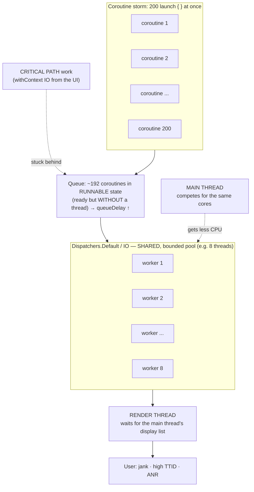

# Coroutine Storm: how launching too many coroutines degrades the whole app

*Draft technical article for the community. Focused on Android/JVM application startup, but applicable to any code based on Kotlin Coroutines.*

> **TL;DR**
> A *coroutine storm* is launching a disproportionate number of coroutines at the same time against a **shared, bounded** thread pool (`Dispatchers.Default`, `Dispatchers.IO`). Because those dispatchers are **process-wide singletons**, the storm is not "contained" where it happens: it saturates the pool for the **entire** application, steals CPU time from the **main thread**, and the user feels it as **slow startup, jank and ANRs**. Yes, a storm launched anywhere in the app can degrade screens and flows that have nothing to do with it.

---

## 1. What a "coroutine storm" is

Launching a coroutine is cheap. Launching *ten thousand* coroutines that all want to run **at the same time** is not.

A coroutine does not run in a vacuum: it needs a **thread** to run its body. That thread is provided by a `CoroutineDispatcher`. And the stock dispatchers are backed by **finite** thread pools:

| Dispatcher | Actual parallelism (by default) | Correct use |
|---|---|---|
| `Dispatchers.Default` | `max(2, number of cores)` | **CPU-bound** work (parsing, mapping, computation) |
| `Dispatchers.IO` | 64 threads (or the number of cores if larger) | **Blocking** work: disk, network, DB |
| `Dispatchers.Main` | 1 (the UI thread) | UI, lightweight orchestration |

Key points that make the storm possible:

1. **They are bounded pools.** On an 8-core phone, `Default` runs ~8 CPU-bound coroutines at a time. `IO` accepts up to 64 simultaneous blocking calls.
2. **`Default` and `IO` share the same elastic thread pool** underneath. `IO` can grow up to its limit, but it does not live in a separate universe.
3. **They are process-wide singletons.** There is *one* `Dispatchers.Default` and *one* `Dispatchers.IO` for the **whole** application: your code, your libraries, your third-party SDKs, image decoding, the network layer... all of them share the same threads.
4. **Everything competes for the same physical cores.** Even the main thread (`Main`) is just *one more operating system thread* fighting for CPU against the 8, 16 or 64 worker threads that the storm woke up.

When you launch more *ready-to-run* coroutines than the pool can serve, the rest do not disappear: **they are queued**. That time spent "ready but waiting for a thread" is the heart of the problem.

> **The signal that matters: `queueDelay`.** It is not how long your task takes to execute, but **how long it waits from the moment it is ready to run until it actually starts**. In a saturated pool, `queueDelay` shoots up even though every individual task is fast.

---

## 2. Why startup is the perfect epicenter

Startup concentrates all the ingredients for a storm:

- **Everything wants to run "now".** App Startup / initializers, the DI graph, analytics SDKs, crash reporting, remote config, feature flags, cache preloading... everything fires in the same time window.
- **The dominant pattern is "fire and forget".** It is tempting to solve every heavy initialization with a `scope.launch(Dispatchers.IO) { ... }` per component. With 30-40 initializers, you are already launching 30-40 coroutines that compete for the same pool in the hottest second of the process.
- **The disk is cold.** On a cold start the file system caches are empty: every read takes longer, every `IO` thread is held longer, and therefore **more coroutines get queued** waiting for permission to run.
- **The main thread is on the critical path.** The first frame, the first screen and, on Android, the `ContentProvider`/`Application`/first `Activity` all run on the main thread. Any work that steals CPU from it at that moment delays what the user **sees**.

The typical result: **high Time To Initial Display (TTID), jank on the first screen and, in the worst case, an ANR**, not because one task is slow, but because hundreds of fast tasks step on each other.

---

## 3. The mechanics of the damage

Visually, a storm looks like this: many more *ready-to-run* coroutines than available threads, a growing queue (`queueDelay`), and the main thread fighting for the same cores.



A storm does damage on several fronts at once:

### 3.1 Pool saturation and queueing (`queueDelay`)
If there are 8 threads in `Default` and you launch 200 CPU-bound tasks, 192 wait. Task #193 may be trivial, but it does not start until a thread is freed. Your **critical path** work ends up behind deferrable work.

### 3.2 Oversubscription and context switching
If you also put **blocking** work in `Default` (bad practice), the few CPU threads end up taken, sleeping on I/O. The scheduler cannot advance the real CPU work and the system wastes time on context switches instead of useful progress.

### 3.3 Memory pressure and GC
Each coroutine retains its continuation frame and **everything it captures** (contexts, callbacks, buffers). Thousands of simultaneous coroutines = thousands of live objects + allocations right at the moment of highest memory pressure in the process. More GC → more pauses → more jank.

### 3.4 Contention on downstream shared resources
The pool is not the only bottleneck. The storm moves it to:
- **SQLite / Room**: a single *writer*. 50 concurrent writes are serialized anyway, but now with 50 blocked threads waiting.
- **DataStore / SharedPreferences**, the disk head, OkHttp's *connection pool* (`Dispatcher.maxRequests`), locks in your own code...

"Fake" concurrency (launching everything together) does not speed up an intrinsically sequential resource; it only adds blocked threads and queueing latency.

### 3.5 Indirect starvation of the main thread
The most underestimated one, and the one that is felt the most. We cover it in full in section 5.

---

## 4. The key question: does a storm elsewhere degrade the whole app?

**Yes, and it is the most important consequence to understand.**

The common mental mistake is assuming isolation:

> *"I launch it on a background dispatcher, so it does not affect the rest."*

That is **false**. `Dispatchers.Default` and `Dispatchers.IO` are **process-global resources**. A storm in feature X does not compete only with itself: it competes with **everything else that uses those same dispatchers**, including the UI.

### Example 1 — Background sync that ruins scrolling
The user scrolls a list with images. The image library decodes on `Dispatchers.Default`. At that moment, a background sync fires:

```kotlin
// In some ViewModel / worker, far from the UI
items.forEach { item ->
    scope.launch(Dispatchers.IO) {   // 500 coroutines at once
        repository.sync(item)
    }
}
```

`IO` fills up (cap of 64), and since it shares an elastic pool with `Default`, image decoding starts to queue. Result: **dropped frames on a screen that has no relation to the sync.**

### Example 2 — Fan-out during startup
40 async initializers launched at once saturate the pool. The first screen needs to read a flag (`withContext(IO)`) to decide what to show: that read ends up behind the 40 and **TTID** goes up even though the read itself takes 2 ms.

**Conclusion:** the blast radius of a storm is **not the module where it happens**; it is **the whole process**.

---

## 5. Where the user feels it: Main Thread, Compose and Render Thread

This is the core of why it matters: the storm runs on *background* threads, but **the damage emerges in the rendering pipeline**, which is the only thing the user perceives.

### 5.1 The frame budget (the golden rule)
For the UI to feel fluid, every frame must be produced within its budget:

| Display refresh rate | Budget per frame |
|---|---|
| 60 Hz | ~16.6 ms |
| 90 Hz | ~11.1 ms |
| 120 Hz | ~8.3 ms |

If a frame's work does not finish in time, that frame is **dropped** (*dropped/janky frame*) and the user sees a stutter. Dropping many frames in a row = choppy scrolling. If the main thread does not respond to an input within ~5 s = **ANR**.

### 5.2 The pipeline of a frame (simplified)
```
Input / animation
      │
      ▼
[ MAIN THREAD (UI thread) ]
   • recomposition (Compose) / measure + layout + draw (record)
   • also runs your UI coroutines (Dispatchers.Main)
      │  produces the display list
      ▼
[ RENDER THREAD ]
   • rasterizes on the GPU from the display list
      │
      ▼
   Frame on screen
```

Two central ideas:
1. **The RenderThread depends on the Main Thread.** The RenderThread can only draw what the main thread has already *recorded* (the display list). If the main thread is late with that work, the RenderThread has nothing to rasterize in time → dropped frame, even if the GPU is free.
2. **The Main Thread is not isolated from the pool.** It is an OS thread that competes for the same cores as the worker threads. A CPU-bound storm in `Default` **steals cycles from the main thread at the OS scheduler level**, even though your code never explicitly "blocks" the main thread.

### 5.3 How the storm attacks each piece

**Main Thread — two paths of damage:**
- **CPU theft (indirect):** the storm wakes N worker threads that fight for the cores. The main thread gets less CPU time, recomposition/layout takes longer, and the frame deadline is missed.
- **Suspension waiting on background:** UI flows almost always do `withContext(IO/Default) { ... }` and **wait** (reading a preference, a file, a mapping). If that `withContext` cannot get a thread because the pool is saturated, the UI coroutine stays suspended → the screen does not move forward.

**Jetpack Compose — a critical detail:**
`LaunchedEffect`, `rememberCoroutineScope()` and `produceState` inherit the composition's `CoroutineContext`, which on Android is tied to **`AndroidUiDispatcher.Main`** (synchronized with the frame clock / `Choreographer`). That is: **by default they run on the main thread.**

- If you launch heavy work inside a `LaunchedEffect` without switching dispatcher, that work runs **on the main thread** and competes frame by frame.
- **Recomposition** also happens on the main thread. Heavy work inside the `@Composable` body (or in a misused `remember`) runs on every recomposition and eats the frame budget.
- Frequent `State` updates coming from a storm (e.g. many flows emitting at once) trigger **recomposition avalanches**, which are also main thread work.

**Render Thread:**
You do not saturate it with coroutines directly, but you leave it "waiting" when the main thread is late with the display list. It also competes for CPU/GPU with everything else. A starved main thread translates into an idle RenderThread that cannot meet the deadline.

### 5.4 What the user sees
- **Longer cold start:** blank screen / frozen splash (high TTID), late first useful content (high TTFD).
- **Jank:** choppy scrolling, animations that "jump", non-fluid transitions.
- **Laggy input:** taps that respond late.
- **ANR:** the "App isn't responding" dialog if the main thread is starved of CPU or blocked for too long.
- **Battery and heat:** dozens of threads spinning at the worst moment.

---

## 6. How to detect it: tools

Do not optimize blindly: **observe first, then bound.**

### 6.1 On the timeline (the most revealing)
- **Perfetto / System Tracing:** the most powerful tool. Look at thread states: a thread in **`Runnable`** (ready but without CPU) for a long time is *the signature of the storm* at the OS level (the equivalent of `queueDelay`). Label your sections with a stable prefix (e.g. `Startup::MyInit`) to see them on the timeline.
- **Android Studio Profiler (CPU / Threads):** shows the thread timeline; you can see the swarm of `DefaultDispatcher-worker-*` fighting for slots while `main` stretches.

### 6.2 Startup and frame metrics
- **Jetpack Macrobenchmark:** `StartupTimingMetric` (TTID/TTFD) and `FrameTimingMetric` (slow frames) in a reproducible way on CI.
- **JankStats** (`androidx.metrics:metrics-performance`): reports janky frames *in production* and lets you attach "state" (which screen/action) to the problematic frame.
- **`adb shell dumpsys gfxinfo <package>`:** percentage of janky frames and a histogram of timings (50th/90th/95th/99th percentiles).
- **Play Console — Android Vitals** and **Firebase Performance:** field data: ANR rate, slow cold start, *frozen frames*.

### 6.3 Hunting improper work on the main thread
- **Logcat / Choreographer:** the classic `Skipped NN frames! The application may be doing too much work on its main thread.`
- **StrictMode** (in debug): detects disk/network I/O on the main thread.

```kotlin
if (BuildConfig.DEBUG) {
    StrictMode.setThreadPolicy(
        StrictMode.ThreadPolicy.Builder()
            .detectDiskReads().detectDiskWrites().detectNetwork()
            .penaltyLog()
            .build()
    )
}
```

### 6.4 Coroutine-specific tools
- **Real thread / dispatcher names:** record which thread each task ran on (`Thread.currentThread().name`). If everything landed on the same workers, there is contention.
- **`kotlinx-coroutines-debug`:** `DebugProbes.install()` + `DebugProbes.dumpCoroutines()` to see how many coroutines are alive and where they are suspended. Run the JVM with `-ea -Dkotlinx.coroutines.debug`.
- **Coroutines panel in the Android Studio debugger:** inspection of active coroutines and their state.

### 6.5 Compose-specific
- **Layout Inspector → recomposition counts:** detects excessive recompositions (a symptom of a state storm or of heavy work during composition).
- **Compose compiler reports** (stability/skippability): help reduce unnecessary recompositions.

### 6.6 Your own instrumentation
Measure and expose **`queueDelay`** and **peak concurrency** for your tasks. In this library, `StartupMetric` already exposes `queueDelayMs`, `concurrentActiveCount`, `dispatcherName` and `threadName` precisely so you can *see* the storm before deciding whether it needs to be bounded.

---

## 7. Gallery of bad and good practices

### 7.1 Unbounded fan-out

**❌ Bad** — one coroutine per item, all at once, in `GlobalScope`:
```kotlin
fun preloadEverything(items: List<Item>) {
    items.forEach { item ->
        GlobalScope.launch(Dispatchers.IO) {   // no lifecycle, no quota
            cache.put(item.id, readFromDisk(item))
        }
    }
}
```

**✅ Good** — structured concurrency + explicit quota:
```kotlin
suspend fun preloadEverything(items: List<Item>) = coroutineScope {
    val gate = Semaphore(permits = 4)
    items.forEach { item ->
        launch(Dispatchers.IO) {
            gate.withPermit { cache.put(item.id, readFromDisk(item)) }
        }
    }
}
```
*Why:* the `Semaphore` bounds the peak that saturates the global pool; the `coroutineScope` provides cancellation and lifecycle.

### 7.2 Wrong dispatcher

**❌ Bad** — blocking I/O stealing CPU threads:
```kotlin
withContext(Dispatchers.Default) { file.readBytes() }   // blocking on Default
```

**✅ Good** — each job in its own pool:
```kotlin
withContext(Dispatchers.IO) { file.readBytes() }        // I/O on IO
withContext(Dispatchers.Default) { parseAndMap(bytes) } // CPU on Default
```

### 7.3 `LaunchedEffect` with heavy work (runs on Main)

**❌ Bad** — the work runs on the main thread and pins the frame:
```kotlin
@Composable
fun Screen(id: String) {
    var data by remember { mutableStateOf<Data?>(null) }
    LaunchedEffect(id) {
        data = repository.loadHeavy(id)   // ⚠️ by default: Dispatchers.Main
    }
}
```

**✅ Good** — the heavy work is moved off the main thread:
```kotlin
@Composable
fun Screen(id: String) {
    var data by remember { mutableStateOf<Data?>(null) }
    LaunchedEffect(id) {
        data = withContext(Dispatchers.IO) { repository.loadHeavy(id) }
    }
}
```
*Even better:* let the work live in the `ViewModel` and have the UI observe state; the `Composable` only collects.

### 7.4 Heavy computation during recomposition

**❌ Bad** — recomputed on every recomposition, on the main thread:
```kotlin
@Composable
fun Total(items: List<Item>) {
    val total = items.sumOf { it.expensiveScore() } // runs on every recompose
    Text("$total")
}
```

**✅ Good** — cached and decoupled from the recomposition rate:
```kotlin
@Composable
fun Total(items: List<Item>) {
    val total by remember(items) {
        derivedStateOf { items.sumOf { it.expensiveScore() } }
    }
    Text("$total")
}
```

### 7.5 Flow collection without lifecycle awareness

**❌ Bad** — keeps collecting (and recomposing) in the background, wasting resources:
```kotlin
val state by viewModel.state.collectAsState()
```

**✅ Good** — respects the lifecycle:
```kotlin
val state by viewModel.state.collectAsStateWithLifecycle()
```
And in classic Views:
```kotlin
lifecycleScope.launch {
    repeatOnLifecycle(Lifecycle.State.STARTED) {
        viewModel.state.collect { render(it) }
    }
}
```

### 7.6 `runBlocking` at startup / on the main thread

**❌ Bad** — blocks the main thread (ANR guaranteed if there is I/O):
```kotlin
override fun onCreate() {
    val config = runBlocking { remoteConfig.fetch() } // ⛔ on Main
}
```

**✅ Good** — async initialization with an explicit synchronization point:
```kotlin
// Launch the async load; let the UI wait only for what it needs, when it needs it.
appScope.launch { remoteConfig.warmUp() }
// ...and in the screen that requires it:
val config = remoteConfig.awaitReady()
```

### 7.7 Everything *eager* at startup

**❌ Bad** — initializing 30 SDKs in a blocking/eager way before the first frame.

**✅ Good** — split by criticality:
- **Critical path:** the bare minimum.
- **Deferrable:** `lazy`, or triggered after the first frame / on demand by the screen that uses it.

### 7.8 Backpressure instead of blind fan-out

**❌ Bad:**
```kotlin
items.forEach { scope.launch { process(it) } } // N coroutines at once
```

**✅ Good** — bounded, steady throughput:
```kotlin
items.asFlow()
    .flatMapMerge(concurrency = 4) { item -> flow { emit(process(item)) } }
    .collect()
```

### 7.9 Bounding the pool for a subsystem

When a feature *has to* do a lot of concurrent work, isolate it from the rest with a **bounded view** of the pool (it does not create new threads, it only limits how many it uses at a time):
```kotlin
private val syncDispatcher = Dispatchers.IO.limitedParallelism(4)
```

> **Watch out for deadlocks when bounding:** if a parent task acquires a permit/slot and then waits for a child that also needs it, with a low quota (e.g. 1) you get a deadlock. Rule: **resolve dependencies BEFORE acquiring the permit**; never hold a permit while waiting for another task that also requests one.

---

## 8. Quick checklist

- [ ] Do I launch N coroutines where N depends on data (items, features, SDKs)? → bound with `Semaphore`, `limitedParallelism` or `flatMapMerge(concurrency)`.
- [ ] Blocking work on `Default` or `Main`? → move it to `IO`.
- [ ] `LaunchedEffect` / `rememberCoroutineScope` with heavy work? → `withContext` to a background dispatcher (or move it to the ViewModel).
- [ ] Expensive computation in the `@Composable` body? → `remember` / `derivedStateOf`.
- [ ] Do I collect flows in a lifecycle-aware way? → `collectAsStateWithLifecycle` / `repeatOnLifecycle`.
- [ ] `runBlocking` at startup or on Main? → remove it; use async synchronization points.
- [ ] Does all of this **need** to run before the first frame? → defer what does not.
- [ ] Do I measure `queueDelay`, peak concurrency, janky frames and TTID/TTFD, or am I guessing? → instrument first (Perfetto, Macrobenchmark, JankStats, gfxinfo).
- [ ] Do I acquire permits/locks **after** resolving dependencies? → avoid deadlocks with low quotas.
- [ ] Do I respect cancellation in long loops? → `ensureActive()` / `yield()`; never swallow `CancellationException`.

---

## 9. Closing

The central lesson: **the standard dispatchers are global, bounded resources, and the main thread competes with them for CPU.** Coroutines are cheap to create, but *real parallelism* is not. A spike of coroutines, at startup or anywhere else, is not isolated: it saturates the shared pool, steals cycles from the Main Thread, delays Compose recomposition and the Render Thread's work, and **degrades screens and flows that have no relation** to the code that launched the storm.

The recipe is simple to state and disciplined to apply: **watch `queueDelay` and frames, respect structured concurrency, choose the right dispatcher, keep heavy work out of main/Compose and bound concurrency** so that no part of the app can monopolize the threads, or the CPU, of all the others.

---

*Draft. The `queueDelayMs` / `concurrentActiveCount` / `dispatcherName` examples come from the instrumentation of [android-app-startup-extension](https://github.com/santimattius/android-app-startup-extension), but the phenomenon and the mitigations apply to any Kotlin code based on Coroutines.*
